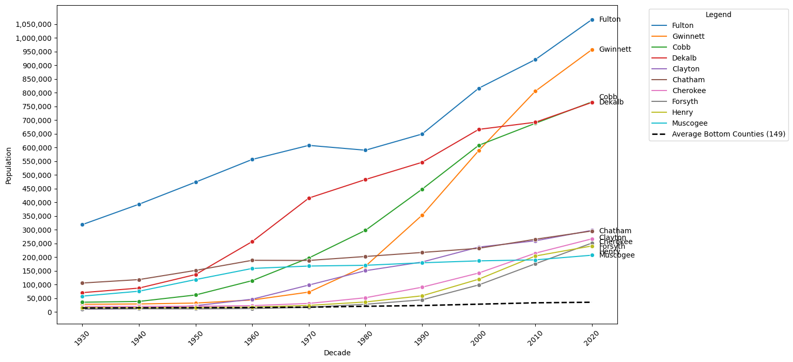
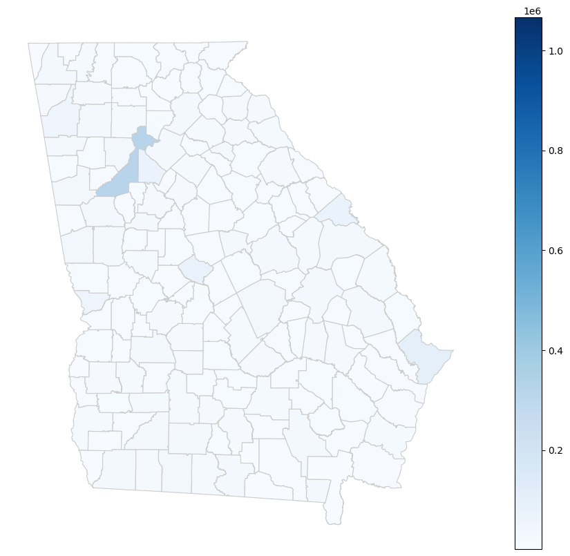
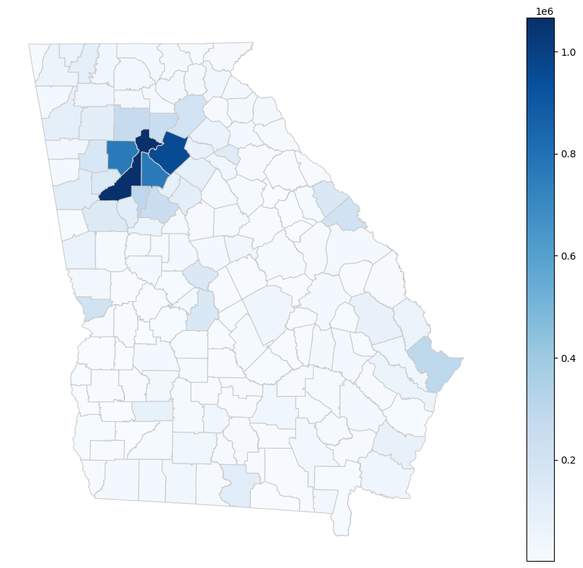
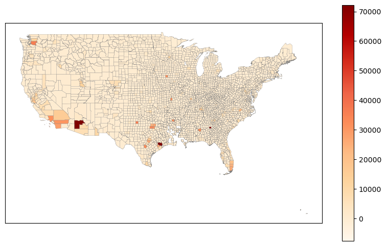
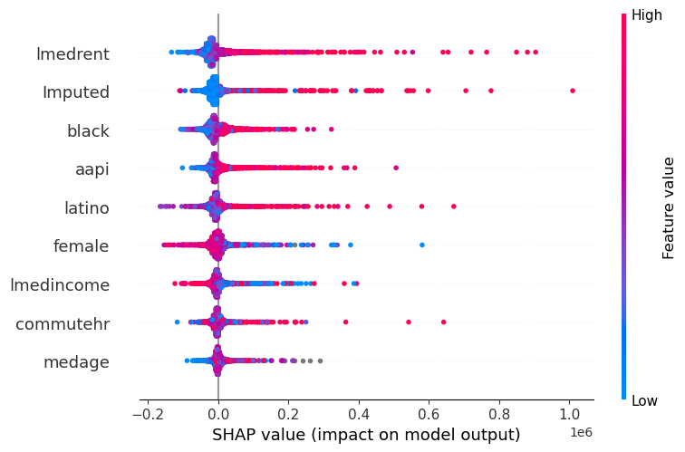

# The Data Metropolis: Navigating Urban Growth Through Machine Learning

Jonas Wei

West Forsyth High School, Cumming, Georgia



“The Data Metropolis,” is a science fair project that aspires to better the understanding of this question: How do different factors drive the dynamics of the urban ecosystem? Inspired by Atlanta, the AP Human Geography poster-child of urban sprawl, the project aims to provide valuable insights surrounding geodata, population, and finance to make informed decisions about sustainable city development for the improvement of many businesses, companies, and communities. Through the utilization of regressive machine learning, innovative visualizations, and comprehensive statistical analysis, this research aims to better the societal understanding of the metropolitan landscape.

The regression model analyzes a combination of demographic, population, and financial data to predict zip codes at risk for sprawl. Beforehand, it was hypothesized that multiple metrics and diverse geodata such as population trends, land use changes, forestry, soil erosion, and infrastructure, would influence predictions. The visualization and modeling of many factors ultimately allowed for a holistic perspective on the urbanization process, and acted as a jump start for research in a worldwide phenomena to be applied in the United States.

The exact outcomes of the project are documented in its research paper. This research delves specifically into the finding relationships among various factors and population growth. Future project developments would seek to include more elements perhaps in an unsupervised machine learning algorithm that can find subtle relationships among variables. An overarching goal stands to aid urban planners, real estate developers, and businesses with actionable insights which can hopefully nurture the implementation of effective, environmental urban policies to face the challenges posed by rapid urbanization of the 21st century.

## What the data shows

Atlanta's growth after 1970 mostly happened outside Fulton County. Fulton actually lost people between 1970 and 1980 (607,592 to 589,904). Over the same stretch the ring of suburban counties took off:

| County | 1950 | 1970 | 2020 |
|---|---:|---:|---:|
| Gwinnett | 32,320 | 72,349 | 957,062 |
| Cobb | 61,830 | 196,793 | 766,149 |
| Forsyth | 11,005 | 16,928 | 251,283 |
| Fulton | 473,572 | 607,592 | 1,066,710 |

Gwinnett grew about 30x in seventy years. Forsyth, where I grew up, went from under 17,000 people in 1970 to over 250,000. The other 149 Georgia counties averaged about 35,000 people each in 2020.

Georgia by county, 1930 and 2020, on the same color scale:

<table>
  <tr>
    <td></td>
    <td></td>
  </tr>
  <tr>
    <td align="center">1930</td>
    <td align="center">2020</td>
  </tr>
</table>

Nationally, I fit a straight line to each county's 2010–2019 population estimates and mapped the slope (people added per year). The fastest-growing counties were Maricopa, AZ (about 72,000 per year) and Harris, TX (about 71,500), followed by King, WA, Clark, NV, and Tarrant, TX.



## The model

`05_sprawl_model_xgboost.ipynb` joins three datasets on ZIP code and county name:

- ZIP-level demographics from the Census: share female, median age, Black, Asian/Pacific Islander, and Latino population, commute time, median rent, median income
- 2012 county government finance data
- 2012 county population estimates (the target)

An XGBoost regressor predicts county population from those features. I tuned learning rate and tree depth with `GridSearchCV`, compared three configurations, and used SHAP to see which features the model leaned on.



Median rent and the county finance figure had the most influence, then the racial and ethnic composition variables. Median age and commute time mattered least.

### Results and limitations

The best model had a test RMSE of about 411,000 people. That is a big error for predicting county population. The single-feature correlations were weak too (the strongest, median rent, was r = 0.26). Looking back as a college student, a few things explain it:

- Counties were matched by name only, so same-named counties in different states (Bourbon County exists in both Kentucky and Kansas) could merge with the wrong data.
- Many ZIP codes map to the same county, so the rows aren't independent and the train/test split leaks information.
- The model predicts population *level*, not growth. Predicting the 2010–2019 slope directly would match the research question better.

## Repository layout

```
notebooks/
  01_us_state_population.ipynb      state populations 1910–2020, top 10 states over time
  02_us_county_growth.ipynb         county growth rates 2010–2019, national map
  03_georgia_county_maps.ipynb      Georgia county maps for each decade, 1930–2020
  04_georgia_population_trends.ipynb  line chart of Georgia's ten largest counties
  05_sprawl_model_xgboost.ipynb     feature joins, XGBoost model, SHAP analysis
data/                               Census population, demographic, and finance CSVs
data/shapefiles/                    U.S. state, U.S. county, and Georgia county boundaries
figures/                            charts exported from the notebooks
```

## Running it

```bash
pip install -r requirements.txt
jupyter notebook notebooks/
```

Data paths are relative to the `notebooks/` folder. Run each notebook's cells top to bottom. Built with pandas, GeoPandas, matplotlib, seaborn, scikit-learn, XGBoost, and SHAP.
